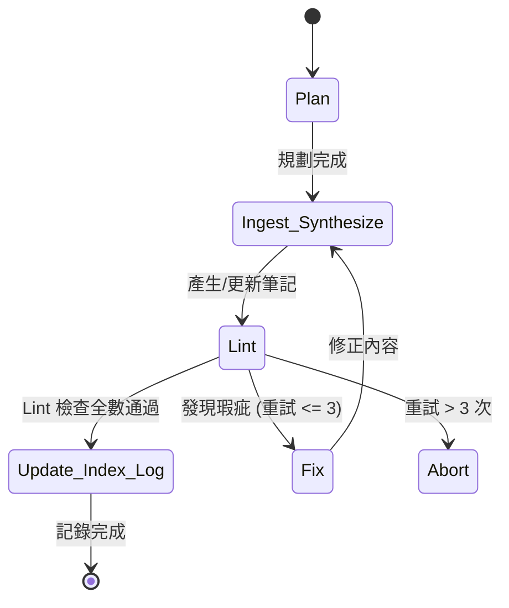
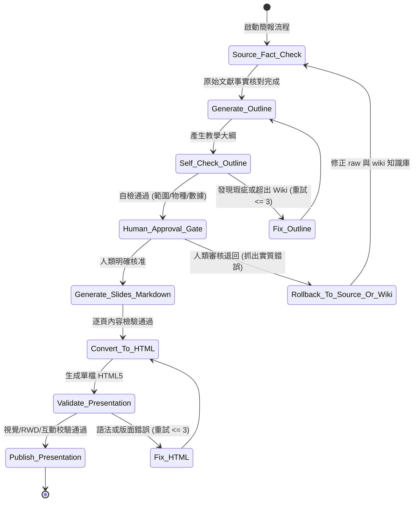

# AGENTS.md - LLM Wiki 維護與教學簡報生成規範

本專案採用 Andrej Karpathy 提出的 **LLM Wiki** 方法，由 Coding Agent 負責維護純文字 Markdown 知識庫，取代傳統黑盒子向量資料庫（Vector RAG）。本手冊定義 Coding Agent 在維護知識庫、處理資料 Ingest 及生成下游應用時必須嚴格遵守的架構規範與狀態機流程。

---

## 核心設計哲學

1. **編譯器思維（Compiler Mindset）**：Agent 不是被動檢索器，而是主動編譯器。將未結構化或半結構化的原始官方文獻（Raw Sources），編譯、綜合為高資訊密度、互相參照、原子化的 Markdown 概念筆記。
2. **單一真實資料來源（Single Source of Truth, SSOT）**：所有下游產物（如初學者 HTML 教學簡報）均必須完全源自 `wiki/` 與 `INDEX.md`，杜絕幻覺與未引用的宣稱。
3. **可驗證性與精準溯源**：所有栽培數據（溫度、濕度、光照遮陰率、澆水頻率、稀釋倍數）必須標明具體數值、適用情境及對應的 `[SRC-xx]` 來源出處。
4. **誠實與不可逆記錄**：嚴禁將未執行的流程標記為已完成；每次檢查節點必須留下具體數據與日誌。

---

## 一、 專案結構與命名規範

```text
fern-learning-wiki/
├── AGENTS.md                  # 本手冊：Agent 執行規範、狀態機與檢查規則
├── INDEX.md                   # 知識地圖、概念階層架構、主題分類與全域索引
├── CHANGELOG.md               # 實際執行與檢查日誌（節點、錯誤、修復、重試紀錄）
├── raw/                       # 官方來源保存區（唯讀原文摘錄與 Metadata）
│   ├── SRC-01_tfri_fern_basics.md
│   ├── SRC-02_tndais_asplenium.md
│   ├── SRC-03_tydares_platycerium.md
│   ├── SRC-04_kdais_adiantum.md
│   └── SRC-05_ttdares_nephrolepis.md
├── wiki/                      # LLM 維護之原子化 Markdown 概念筆記（kebab-case）
│   ├── fern-biology-and-morphology.md
│   ├── asplenium-antiquum-care.md
│   ├── platycerium-care-and-mounting.md
│   ├── adiantum-care.md
│   ├── nephrolepis-biserrata-care.md
│   ├── watering-and-humidity-management.md
│   ├── substrate-and-media.md
│   └── environmental-control-and-troubleshooting.md
└── presentation/              # 下游應用：HTML 教學簡報
    ├── outline.md             # 簡報大綱（需人類確認）
    ├── slides.md              # 逐頁檢核草稿
    └── index.html             # 獨立純 HTML5 互動簡報（預留 assets/ 圖片插槽）
```

### 命名與格式規範
1. **語言**：正文使用繁體中文（臺灣習慣用語，如：水苔、上板、走莖、孢子體、配子體、日燒、介殼蟲）。
2. **學名與專有名詞**：保留植物學名（斜體，如 *Platycerium*、*Asplenium antiquum*、*Adiantum*、*Nephrolepis biserrata*）與英文專有名詞（如 sporophyte, gametophyte, epiphyte）。不得隨意變更學名或混淆物種。
3. **檔案命名**：`wiki/` 概念筆記一律使用英數小寫及連字號 `kebab-case.md`。
4. **YAML Frontmatter**：每篇 Wiki 筆記頂部必須包含：
   ```yaml
   ---
   title: "筆記繁體中文標題"
   aliases: ["中文別名1", "英文別名"]
   sources: ["SRC-01", "SRC-03"]
   tags: ["分類標籤1", "栽培技術"]
   last_updated: "2026-11-23"
   ---
   ```
5. **知識關聯語法**：採用 Obsidian 相容之 `[[概念頁檔名|顯示名稱]]` 雙向連結語法。

---

## 二、 雙軌 Graph / Loop 工作流機制

### 軌道一：Wiki 維護 Loop（Ingest & Synthesis）



#### 各節點具體規則：
1. **Plan（規劃節點）**：
   - 讀取目標 `raw/SRC-xx.md` 內容。
   - 掃描既有 `INDEX.md` 與 `wiki/` 目錄。
   - 產出本次預計新建（Create）與增量更新（Update）的概念頁面清單。
2. **Ingest & Synthesize（綜合編譯節點）**：
   - 萃取核心栽培數據（光照、溫度、水分、介質、病蟲害）。
   - 保留不同物種之個別需求（不任意混為一談）。
   - 建立雙向 `[[WikiLink]]` 與引用標記 `[^SRC-xx]`。
3. **Lint（自動校驗節點）**：
   - **斷鏈檢查（No Dead Links）**：所有 `[[filename]]` 必須指向實際存在的 `.md` 檔案。
   - **孤島檢查（No Orphan Pages）**：所有 `wiki/` 檔案必須被 `INDEX.md` 或其他頁面引用至少一次。
   - **引用檢查（Source Attribution）**：所有明確數據必須有對應的來源編號，未證實者標記 `[待查證]`。
   - **結構檢查（Frontmatter & Schema）**：檢查 YAML frontmatter 是否齊全。
4. **Fix & Rollback（錯誤修正與退回節點）**：
   - 若 Lint 檢查未通過，記錄錯誤原因（例如：`wiki/care.md 存在無效連結 [[unknown-page]]`）。
   - 累計重試計數器 `retry_count += 1`。若 `retry_count <= 3`，退回執行修正；若 `retry_count > 3`，立即終止並回報人類。
5. **Update Index & Log（更新索引與日誌節點）**：
   - 更新 `INDEX.md` 概念地圖與雙向關聯清單。
   - 在 `CHANGELOG.md` 記錄操作歷史、檢驗項目、重試次數與結果。

---

### 軌道二：HTML 教學簡報生成 Graph



#### 各節點具體規則：
1. **Source Fact Check（原始來源事實核對節點）**：在規劃簡報大綱前，必須逐項比對官方原文、`raw/` 摘錄與 `wiki/` 筆記，嚴禁將未經證實之 AI 整理數據或物種特徵當作官方既定事實。
2. **Generate Outline（大綱規劃）**：完全依據 `wiki/` 內容規劃教學單元，每頁精簡為 3~4 個核心教學重點。
3. **Self Check Outline（AI 自檢大綱）**：比對大綱是否超出 Wiki 範疇、有無物種特徵混淆、有無未經核實之數據。
4. **Human Approval Gate（人類確認門檻 - 關鍵卡點）**：
   - **強制暫停**：將大綱提交給人類。若人類審核發現植物學事實錯誤或來源不符，**必須觸發 Rollback 回退至原始來源核對或 Wiki 整理節點**，同步修復底層知識庫，嚴禁僅在簡報層面表面塗改。
5. **Generate Slides Markdown（逐頁內容草稿）**：產出 `presentation/slides.md`，每頁控制在適合投影片閱讀的字數，標記引用與資產插槽。
6. **Convert To HTML（HTML 轉譯）**：生成獨立純 HTML5 投影片（整合現代 CSS 與原生 JavaScript，免 Node.js 建置），預留標準圖片容器：
   ```html
   <div class="slide-visual" data-asset="platycerium-board">
     <!-- 預設質感 SVG 佔位圖示，待後續 assets/ 圖片補上 -->
   </div>
   ```
7. **Validate Presentation（簡報校驗）**：檢查全螢幕播放、鍵盤左右鍵切換、手機 RWD 排版、無外部無效腳本依賴。

---

## 三、 執行日誌規範（CHANGELOG.md 格式）

每次 Ingest、Wiki 更新或簡報生成時，必須在 `CHANGELOG.md` 記錄真實執行歷程：

```markdown
## [YYYY-MM-DD HH:mm] 操作名稱 (如: Ingest SRC-01 & SRC-02)

### 1. 執行目標
- 來源文件：SRC-01, SRC-02
- 預期產出：新建 wiki/xxx.md，更新 wiki/yyy.md

### 2. 狀態機歷程
- [Plan] 掃描現有索引，確認新增概念清單。
- [Ingest & Synthesize] 寫入原子概念筆記，建立 [[WikiLink]]。
- [Lint Check] 
  - 斷鏈檢查：Pass / Fail (說明具體錯誤)
  - 孤島檢查：Pass / Fail
  - 引用對照：Pass / Fail
- [Fix & Retry] (若有重試，記錄具體修正內容與重試次數)

### 3. 一致性複檢
- INDEX.md 更新狀態：已同步 / 無遺漏
- 最終校驗狀態：PASS (重試次數: 0)
```
