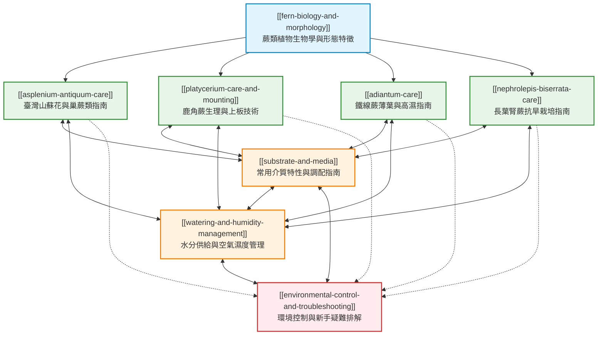

# 蕨類栽培入門 LLM Wiki - 知識地圖與全域索引

本知識庫遵循 Andrej Karpathy 提出的 **LLM Wiki** 方法，由 Coding Agent 依據農業部與試驗改良場所之 5 篇官方權威文獻編譯而成。知識庫揚棄傳統不透明之向量檢索（Vector RAG），採用原子化 Markdown 概念頁、雙向連結圖譜與嚴格來源溯源標註，作為人類讀者與 Agent 查閱栽培知識的「單一真實資料來源（Single Source of Truth, SSOT）」。

---

## 一、 知識庫核心架構與概念圖譜

---

## 二、 主題分類與概念筆記導覽

### 1. 基礎植物學與底層原理
* **[[fern-biology-and-morphology|蕨類植物生物學與形態特徵]]**
  * 演化地位、維管束結構與幼葉捲旋現象（Circinate vernation）
  * 世代交替（Alternation of generations）：雙倍體孢子體 vs 獨立心形原葉體（配子體）
  * 精子游動與受精作用對「連續游離水膜」的剛性依賴原理
  * 來源出處：`SRC-01`, `SRC-05`

### 2. 四大入門代表品種栽培實務
* **[[asplenium-antiquum-care|臺灣山蘇花與巢蕨類栽培指南]]**
  * 臺灣原生三大巢蕨辨識（依農業部文獻）：臺灣山蘇花（*Asplenium nidus*）、山蘇花（*Asplenium antiquum*）、南洋巢蕨（*Asplenium australasicum*）
  * 放射狀鳥巢漏斗形態與氣生根生態適應
  * 60%~80% 遮陰管理、適溫 20~30℃、低溫 15℃ 停滯與 10℃ 寒害防護
  * 簡易孢子播種四步驟與組織培養量產概述
  * 來源出處：`SRC-02`
* **[[platycerium-care-and-mounting|鹿角蕨生長生理與上板栽培技術]]**
  * 二型葉分化：孢子葉（手，星狀毛防蒸散）vs 營養葉（臉，收集腐植質，乾枯老葉絕不可剝除）
  * 桃園農改場綠竹板試驗：環保輕質替代蛇木板技術
  * 關鍵「乾濕循環」澆水法則：夏 3~4 天、冬 1 週、乾透泡盆透心澆透、水苔青苔過濕警訊
  * 花寶二號稀釋 2,000 倍輪流施用
  * 來源出處：`SRC-03`
* **[[adiantum-care|鐵線蕨薄葉特徵與高濕栽培指南]]**
  * 烏黑如絲葉柄（少女的髮絲）與扇形薄質小羽片特徵
  * 薄葉高蒸散限制：半陰明亮散射光環境、避免強光直射
  * 水分管理：盆土微濕潤、高空氣濕度需求（碎石水盤增濕法實務）
  * 介質原則：疏鬆透氣排水良好（標記園藝經驗參考比例）與春季分株法
  * 來源出處：`SRC-04`
* **[[nephrolepis-biserrata-care|長葉腎蕨與腎蕨屬植物抗旱栽培指南]]**
  * 橫向鐵絲狀走莖與革質厚葉耐旱生理（物種特徵精確區分：長葉腎蕨不具球莖，儲水球莖屬於同屬之腎蕨）
  * 廣泛光照適應性（全日照至半日照均可，50%~60% 遮光觀賞品質最佳）
  * 見乾見濕管理、耐微乾旱、盆底嚴禁積水
  * 懸垂吊盆與垂直綠牆景觀美化應用
  * 來源出處：`SRC-05`

### 3. 共通栽培技術與環境調控
* **[[substrate-and-media|蕨類常用介質特性與調配指南]]**
  * 毛細孔隙、通氣孔隙與抗腐穩定性三大原則
  * 水苔、綠竹板、泥炭土、珍珠石、椰纖與樹皮資材特性
  * 四大入門品種專屬配土比例對照表與換盆標準工法
  * 來源出處：`SRC-02`, `SRC-03`, `SRC-04`, `SRC-05`
* **[[watering-and-humidity-management|水分供給與空氣濕度管理技術]]**
  * 「土壤水分」與「空氣濕度」本質差異與新手盲區剖析
  * 乾濕循環（鹿角蕨、腎蕨）vs 常態微濕（鐵線蕨、山蘇）給水節奏
  * 早晨澆水原則與嚴防夜間葉隙積水滯留誘發炭疽病
  * 泡盆法（底吸浸透）與碎石水盤增濕法實務技巧
  * 來源出處：`SRC-01`, `SRC-02`, `SRC-03`, `SRC-04`, `SRC-05`
* **[[environmental-control-and-troubleshooting|環境控制與新手疑難排解]]**
  * 光照遮陰（50%~80%）與溫度耐受閾值（18~30℃ 適溫、15℃ 停滯門檻）
  * 葉尖焦邊、基部黑腐、整株萎凋、全株黃化四大生理障礙對照表
  * 介殼蟲物理酒精防除與高溫高濕炭疽病預防策略
  * 新手外觀異常急救除錯流程圖
  * 來源出處：`SRC-01`, `SRC-02`, `SRC-03`, `SRC-04`, `SRC-05`

---

## 三、 原始資料來源對照矩陣（Source Mapping Matrix）

| 來源編號 | 文獻標題 | 發布機構與作者 | 官方來源連結 | 對應編譯之 Wiki 筆記 |
| :---: | :--- | :--- | :--- | :--- |
| **SRC-01** | 蕨類植物區 | 農業部林業試驗所 / 台北植物園館 | [kmweb.moa.gov.tw/subject/subject.php?id=27202](https://kmweb.moa.gov.tw/subject/subject.php?id=27202) | [[fern-biology-and-morphology]] [[watering-and-humidity-management]] |
| **SRC-02** | 山蘇花品種、習性及繁殖方法 | 農業部臺南區農業改良場 (陳俊仁、謝桑煙、黃山內) | [www.moa.gov.tw/ws.php?id=2573](https://www.moa.gov.tw/ws.php?id=2573) | [[asplenium-antiquum-care]] [[substrate-and-media]] [[watering-and-humidity-management]] [[environmental-control-and-troubleshooting]] |
| **SRC-03** | 鹿角蕨在綠竹板之栽培技術 | 農業部桃園區農業改良場 (李淑真 / 《桃園區農業專訊》第114期) | [kmweb.moa.gov.tw/knowledgebase.php?id=404842](https://kmweb.moa.gov.tw/knowledgebase.php?id=404842) | [[platycerium-care-and-mounting]] [[substrate-and-media]] [[watering-and-humidity-management]] [[environmental-control-and-troubleshooting]] |
| **SRC-04** | [綠化美化] 鐵線蕨 | 農業部高雄區農業改良場 | [www.kdais.gov.tw/ws.php?id=2206](https://www.kdais.gov.tw/ws.php?id=2206) | [[adiantum-care]] [[substrate-and-media]] [[watering-and-humidity-management]] [[environmental-control-and-troubleshooting]] |
| **SRC-05** | 原生蕨類長葉腎蕨之栽培管理與應用 | 農業部臺東區農業改良場 (李文南 等 / 技術專刊第71輯) | [kmweb.moa.gov.tw/theme_data.php?id=2312&theme=agri_book](https://kmweb.moa.gov.tw/theme_data.php?id=2312&theme=agri_book) | [[nephrolepis-biserrata-care]] [[fern-biology-and-morphology]] [[substrate-and-media]] [[watering-and-humidity-management]] [[environmental-control-and-troubleshooting]] |

---

## 四、 知識庫維護與健康度規則

1. **零斷鏈保證（Zero Dead Links）**：本索引與所有概念筆記中的雙向連結語法均經過自動化腳本驗證，嚴格指向實際存在的檔案。
2. **零孤島筆記（Zero Orphan Notes）**：每一篇概念筆記皆被收錄於本索引，並與至少兩篇其他筆記建立具語意關聯的雙向鏈結。
3. **數據來源強制標註**：所有溫度、遮光率、配土比例與稀釋數據均附帶 `[^SRC-xx]` 腳註，杜絕 AI 幻覺。
4. **維護與演進規範**：後續任何文獻 Ingest 或筆記更新，必須嚴格依照 [[AGENTS.md]] 之狀態機迴圈執行 Lint 校驗並記錄於 `CHANGELOG.md`。
