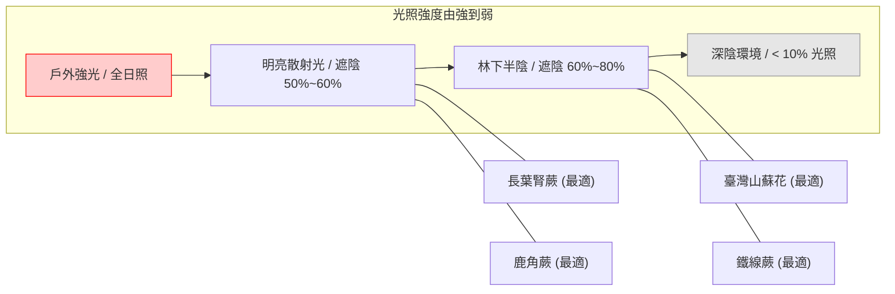
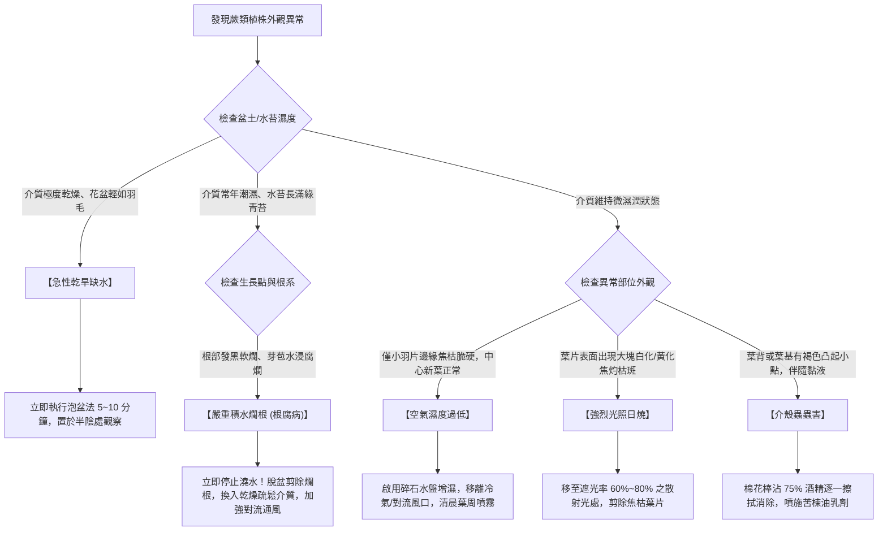

# 環境控制與新手疑難排解

## 一、環境控制三大度量概念釐清：遮光率、光照度與相對濕度

新手在閱讀栽培指南時，常將不同環境指標混淆。在建立環境前，必須釐清三項截然不同的物理度量概念：
1. **遮光率（Shading Rate, %）**：
   * 指人工遮蔭設施（如百吉網）阻擋太陽輻射的百分比。例如山蘇花要求 60%~80% 遮陰 [^SRC-02]，長葉腎蕨在 50%~60% 遮光下觀賞品質最佳 [^SRC-05]。此指標專用於遮蔭網布之選用。
2. **光照強度（Light Intensity, Lux / 勒克斯）**：
   * 指植物葉片表面實際接收到的光通量密度。室內散射光通常在 1,000~3,000 Lux 之間，而戶外直射烈日可超過 50,000~100,000 Lux。薄葉蕨類受強光照射易發生日燒組織壞死 [^SRC-02][^SRC-04]。
3. **空氣相對濕度（Relative Humidity, % RH）**：
   * 指空氣中水蒸氣含量達到飽和的百分比，**與土壤濕潤度完全獨立**。高相對濕度能抑制薄羽片過度蒸散，但不可透過狂澆土壤來代替空氣加濕 [^SRC-04]。

```text
【四大品種環境生理數據速查（嚴格依物種標明條件）】
光照與遮陰條件：
  - 臺灣山蘇花 / 山蘇花：遮光率 60% 至 80% [^SRC-02]（忌烈日直射）
  - 鹿角蕨：遮光率約 50% 或明亮散射光 [^SRC-03]
  - 鐵線蕨：室內明亮散射光或半陰處 [^SRC-04]（園藝經驗參考遮陰約 60%~70% [待查證/通說]）
  - 長葉腎蕨：遮光率 50% 至 60% 最優（亦耐全日照）[^SRC-05]

溫度生理門檻：
  - 生長最適溫：18℃ 至 30℃（山蘇 20~30℃ [^SRC-02]；鹿角蕨 18~30℃ [^SRC-03]）
  - 生長停滯線：低於 15℃ 生長趨緩進入半休眠 [^SRC-02][^SRC-03]
  - 寒害危險線：山蘇低於 10℃ 易受凍害黃化（需移入室內防寒並控水）[^SRC-02]
  - 極端忍受度：鹿角蕨短暫耐受 35℃（需噴霧通風）與 5℃（介質需全乾）[^SRC-03]
```

---

## 二、四大入門代表品種光照需求對照



1. **嚴禁全日照曝曬（鐵線蕨、山蘇花）**：薄葉或著生蕨類受強光照射數小時內即會引發組織溫度急遽上升，破壞葉綠體結構，造成不可逆的「日燒黃斑與焦枯」[^SRC-02][^SRC-04]。
2. **避免深陰無光處**：雖稱「耐陰」，但耐陰不等於「不需要光」。若長期置於無窗封閉房間，植株將因光合作用產物不足而徒長、葉柄纖弱易折、葉色轉為灰暗無光澤，最終衰竭死亡 [^SRC-01][^SRC-05]。

---

## 三、常見生理障礙與病蟲害整合診斷

### 1. 新手最常犯的四大生理障礙對照表

| 病症現象 | 主要肇因 | 機構診斷依據與病徵區隔 | 即時搶救與修正措施 |
| :--- | :--- | :--- | :--- |
| **葉尖焦黑乾枯<br>(焦邊脆葉)** | 空氣濕度過低（< 50%）或直吹冷氣暖氣風口 | 常見於 [[adiantum-care\|鐵線蕨]]。葉尖與葉緣脫水捲縮成焦褐色脆片，但盆土往往仍濕潤 [^SRC-04]。 | 移離風口；採用 [[watering-and-humidity-management\|碎石水盤增濕法]]；勿向盆土盲目狂灌水 [^SRC-04]。剪除嚴重枯羽片。 |
| **葉片泛黃軟爛<br>基部黑腐倒伏** | 介質積水不乾、長期缺氧導致「根腐病」 | 常見於 [[platycerium-care-and-mounting\|鹿角蕨]] 與盆植山蘇。根系變黑萎縮，水苔表面長滿厚青苔，新葉芽苞變黑水浸狀潰爛 [^SRC-03]。 | 立即停水；移至空氣強對流處吹乾；脫盆修剪黑腐死根；換入通氣透水之 [[substrate-and-media\|新介質]] [^SRC-03]。 |
| **整株葉片萎凋下垂<br>葉色發灰失水** | 盆土極度乾旱缺水 | 常見於忘記澆水之 [[nephrolepis-biserrata-care\|長葉腎蕨]]。盆土發白乾裂、重量極輕 [^SRC-05]。 | 立即採用「泡盆法」浸泡清水 5~10 分鐘使介質徹底吸飽；補水後厚質革質葉片在數小時內可挺立復原 [^SRC-05]。 |
| **葉片褪綠泛黃<br>生長全面停滯** | 冬季低溫寒害（< 15℃）或強光日燒 | 臺南農改場指出山蘇在 15℃ 以下停滯、10℃ 以下受害 [^SRC-02]；鹿角蕨極限 5℃ [^SRC-03]。 | 冬季寒流移入室內避風；減少給水維持偏乾（乾土比濕土耐寒）；避開直射烈日維持 60%~80% 遮陰 [^SRC-02][^SRC-03]。 |

---

### 2. 主要病害與蟲害防治要領

#### A. 介殼蟲危害（Scale Insects / 如咖啡硬介殼蟲）
* **受害特徵**：常群聚附生於 [[platycerium-care-and-mounting|鹿角蕨]] 葉背主脈、營養葉凹槽或 [[asplenium-antiquum-care|山蘇花]] 葉軸基部。蟲體呈半球形黃褐色或深褐色硬殼狀，以刺吸式口器吸取植株汁液，造成葉面點狀褪色黃化，並分泌黏稠蜜露誘發黑褐色的「煤煙病」[^SRC-02][^SRC-03]。
* **安全防治與管理措施**：
  * **初期蟲口零星時（物理防除）**：以棉花棒沾取 75% 藥用酒精，逐一輕柔擦抹蟲體，酒精可溶解其蠟質介殼使其脫水死亡。
  * **嚴重受害時（修剪隔離）**：剪除受害嚴重之單片老葉並集中清除，將病株移至獨立通風處隔離。若需使用免登記植物保護資材（如葵無露、苦楝油），應嚴格參照產品包裝之官方核准推薦稀釋倍數操作，避免隨意配製化學農藥造成藥害。

#### B. 真菌性炭疽病與葉斑病（Anthracnose）
* **好發環境**：多發生於高溫多濕、環境氣流停滯且習慣**於夜間向葉片密集噴水**之環境 [^SRC-02][^SRC-03]。
* **病徵表現**：葉片初生黃褐色小水浸狀斑點，隨後擴展為圓形或不規則形深褐色壞死輪紋斑，邊緣具有黃色暈圈，嚴重時病斑穿孔或整葉枯黃掉落 [^SRC-02]。
* **預防法則**：
  * 嚴格遵守 [[watering-and-humidity-management|早晨澆水原則]]，避免夜間水滴長時間殘留於葉片縫隙 [^SRC-02]。
  * 保持盆栽間距至少 15~20 公分，維持空氣流通對流。
  * 發現病葉立即自葉柄基部剪除並集中丟棄，避免病原孢子隨噴霧水滴飛濺擴散。

---

## 四、新手急救除錯流程圖

當您的蕨類出現異狀時，請依下列狀態機流程進行排查診斷：



---

## 五、知識關聯與概念導航
* 基礎理論：[[fern-biology-and-morphology|蕨類植物生物學與形態特徵]]
* 各品種養護要點：
  * [[asplenium-antiquum-care|臺灣山蘇花與巢蕨類栽培指南]]
  * [[platycerium-care-and-mounting|鹿角蕨生長生理與上板栽培技術]]
  * [[adiantum-care|鐵線蕨薄葉特徵與高濕栽培指南]]
  * [[nephrolepis-biserrata-care|長葉腎蕨與腎蕨屬植物抗旱栽培指南]]
* 實務防範操作：
  * [[substrate-and-media|蕨類常用介質特性與調配指南]]
  * [[watering-and-humidity-management|水分供給與空氣濕度管理技術]]

---

## 參考文獻
[^SRC-01]: 農業部林業試驗所 / 台北植物園館, 〈蕨類植物區〉, 農業知識入口網, [https://kmweb.moa.gov.tw/subject/subject.php?id=27202](https://kmweb.moa.gov.tw/subject/subject.php?id=27202).
[^SRC-02]: 陳俊仁、謝桑煙、黃山內, 〈山蘇花品種、習性及繁殖方法〉, 農業部臺南區農業改良場 / 農業部全球資訊網, [https://www.moa.gov.tw/ws.php?id=2573](https://www.moa.gov.tw/ws.php?id=2573).
[^SRC-03]: 李淑真, 〈鹿角蕨在綠竹板之栽培技術〉, 《桃園區農業專訊》第 114 期, 農業部桃園區農業改良場 / 農業知識入口網, [https://kmweb.moa.gov.tw/knowledgebase.php?id=404842](https://kmweb.moa.gov.tw/knowledgebase.php?id=404842).
[^SRC-04]: 農業部高雄區農業改良場, 〈[綠化美化] 鐵線蕨〉, 高雄區農業改良場全球資訊網, [https://www.kdais.gov.tw/ws.php?id=2206](https://www.kdais.gov.tw/ws.php?id=2206).
[^SRC-05]: 李文南、陳敬文、陳姿吟 等, 《原生蕨類長葉腎蕨之栽培管理與應用》, 臺東區農業改良場技術專刊第 71 輯, 農業知識入口網, [https://kmweb.moa.gov.tw/theme_data.php?id=2312&theme=agri_book](https://kmweb.moa.gov.tw/theme_data.php?id=2312&theme=agri_book).
