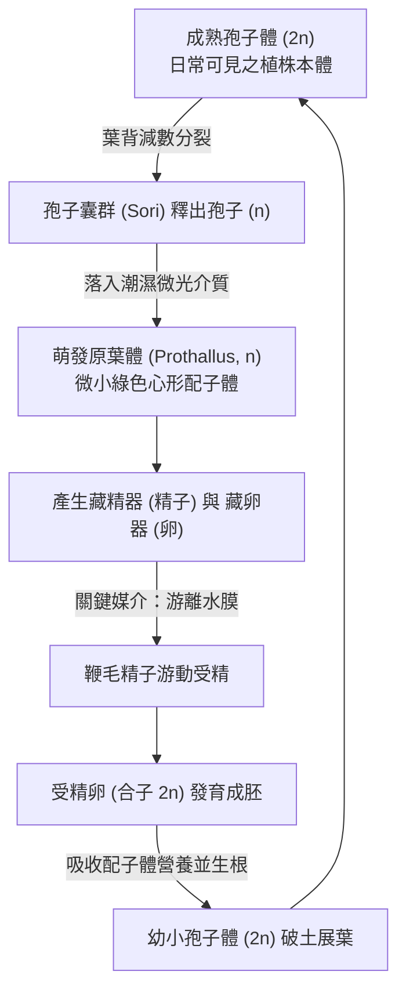

# 蕨類植物生物學與形態特徵

## 一、植物學分類與演化地位
蕨類植物（Ferns）在植物演化史上屬於發達的**維管束植物門（Vascular plants）**，與種子植物同具木質部（Xylem）與韌皮部（Phloem）之分化，負責水分與光合產物的高效輸導 [^SRC-01]。然而，蕨類植物在生殖演化上不產生花、果實或種子，而是透過微小的「孢子」進行繁殖與散佈，在演化層級上介於苔蘚植物與種子植物之間 [^SRC-01]。

臺灣地處亞熱帶與熱帶交界，高山垂直氣候梯度顯著、雲霧帶水氣豐沛，記錄有超過 700 種以上原生蕨類植物，單位面積密度居全球之冠，因而享有「蕨類王國」之美稱 [^SRC-05]。

---

## 二、關鍵形態結構與辨識要點

### 1. 幼葉捲旋現象（Circinate Vernation）
多數蕨類在早春或生長季萌發新芽時，幼葉先端會緊密向下盤捲，形狀如同問號「？」或牧羊人的手杖 [^SRC-01]。
* **生理功能**：盤捲構造能將最嬌嫩的分生組織包裹於核心，有效防禦昆蟲啃食、機械摩擦以及乾燥空氣導致的分生細胞脫水。
* **展開機制**：隨著葉柄與葉軸背側細胞迅速延長，幼葉由基部向上逐段展開伸直。

### 2. 莖部的演化型態
蕨類的莖部型態依生態棲位呈現多樣化適應：
* **短縮莖與匍匐走莖（Stolons）**：多數地生蕨類（如 [[nephrolepis-biserrata-care|長葉腎蕨]] *Nephrolepis biserrata*）莖部極度短縮呈塊狀，自基部四周向外伸出發達如鐵絲狀的橫走莖，負責營養繁殖與佔領地表 [^SRC-05]。
* **氣生根與短縮塊莖**：著生型蕨類（如 [[asplenium-antiquum-care|山蘇花類]] *Asplenium* spp.）莖部為直立短柱狀，四周被覆大量海綿狀氣生根，用以抓附宿主樹皮並儲存露水 [^SRC-02]。
* **木質化直立樹幹**：少數樹蕨類（如筆筒樹 *Cyathea lepifera*、桫欏科）具有高聳氣生直立莖 [^SRC-01]。

### 3. 特化器官與儲水構造
部分蕨類演化出對抗逆境的特化組織：
* **地下儲水球莖（Tubers）**：同屬之腎蕨（*Nephrolepis cordifolia*）走莖上能長出富含水分與多醣體之球形塊莖；而 [[nephrolepis-biserrata-care|長葉腎蕨]]（*Nephrolepis biserrata*）本身不具球莖，主要依靠革質厚羽葉與發達走莖抗蒸散 [^SRC-05]。
* **腐植質收集葉（營養葉）**：[[platycerium-care-and-mounting|鹿角蕨]]（*Platycerium* spp.）演化出圓盾狀貼生老葉，專門截留森林落葉形成海綿腐植層 [^SRC-03]。

---

## 三、生活史與世代交替（Alternation of Generations）

蕨類植物的生活史具有經典的**獨立雙世代交替**特徵，即其「孢子體」與「配子體」皆能獨立進行光合作用生活，此點顯著有別於配子體高度退化且寄生於母體上的種子植物 [^SRC-01]。

### 1. 孢子體世代（Sporophyte, 2n）
我們日常栽培欣賞、具有根、莖、葉完整構造的植物本體，即為雙倍體的無性世代（孢子體）[^SRC-01]。發育成熟後，葉背或特定孢子葉邊緣會產生密集的「孢子囊群（Sori）」，內部孢子母細胞經減數分裂產生數以萬計微小輕盈的單倍體「孢子（Spores）」[^SRC-01]。

### 2. 配子體世代（Gametophyte, n）
孢子飄散至潮濕陰涼介質後萌發，初期發育為單列細胞的原絲體，隨後分裂形成約 2~5 公釐大小、心形扁平的綠色「原葉體（Prothallus）」[^SRC-01]。原葉體腹面著生假根以固定介質，並分化出產生雄性配子的**藏精器（Antheridium）**與產生雌性配子的**藏卵器（Archegonium）**[^SRC-01]。

### 3. 受精作用對「游離水」的絕對依賴
蕨類精子具備游動鞭毛，受精作用發生的**唯一充要條件是原葉體表面必須覆蓋一層連續的「游離水薄膜」**[^SRC-01]。精子感應藏卵器分泌的化學物質後，必須藉由水膜游向藏卵器完成受精 [^SRC-01]。

> [!IMPORTANT]
> **栽培環境的核心啟示**：
> 蕨類生殖受精對水膜的剛性依賴，決定了其原生地多分布於陰濕林下或溪谷泉旁。在居家栽培中，無論是維持 [[watering-and-humidity-management|空氣濕度與水分供給]]，抑或調配具保水與透氣性的 [[substrate-and-media|介質資材]]，皆源自這項底層生物學特性 [^SRC-01]。

---

## 四、知識關聯與概念導航
* 栽培實務應用：
  * 著生漏斗型：[[asplenium-antiquum-care|臺灣山蘇花與巢蕨類栽培指南]]
  * 附生二型葉：[[platycerium-care-and-mounting|鹿角蕨生長生理與上板栽培技術]]
  * 薄葉高濕型：[[adiantum-care|鐵線蕨薄葉特徵與高濕栽培指南]]
  * 強健抗旱型：[[nephrolepis-biserrata-care|長葉腎蕨與腎蕨屬植物抗旱栽培指南]]
* 環境環控技術：
  * [[substrate-and-media|蕨類常用介質特性與調配指南]]
  * [[watering-and-humidity-management|水分供給與空氣濕度管理技術]]
  * [[environmental-control-and-troubleshooting|環境控制與新手疑難排解]]

---

## 參考文獻
[^SRC-01]: 農業部林業試驗所 / 台北植物園館, 〈蕨類植物區〉, 農業知識入口網, [https://kmweb.moa.gov.tw/subject/subject.php?id=27202](https://kmweb.moa.gov.tw/subject/subject.php?id=27202).
[^SRC-05]: 李文南、陳敬文、陳姿吟 等, 《原生蕨類長葉腎蕨之栽培管理與應用》, 臺東區農業改良場技術專刊第 71 輯, 農業知識入口網, [https://kmweb.moa.gov.tw/theme_data.php?id=2312&theme=agri_book](https://kmweb.moa.gov.tw/theme_data.php?id=2312&theme=agri_book).
