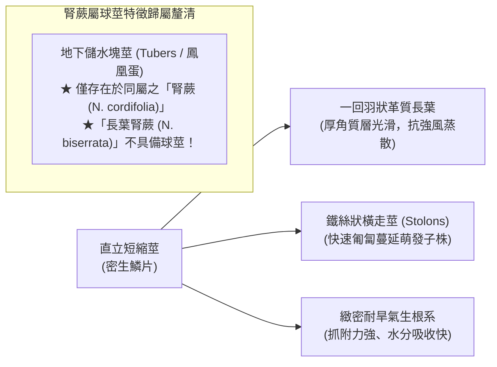

# 長葉腎蕨與腎蕨屬植物抗旱栽培指南

## 一、植物學分類與腎蕨屬代表種

長葉腎蕨屬於腎蕨科（Nephrolepidaceae，部分分類系統置於骨碎補科 Davalliaceae）腎蕨屬（*Nephrolepis*），為臺灣與泛熱帶地區分佈極廣之大型多年生草本蕨類植物 [^SRC-05]。

在觀賞園藝與居家綠化中，腎蕨屬三大常見物種之形態比對如下 [^SRC-05]：

| 物種名稱 | 學名 | 形態特徵與株型大小 | 生態習性與應用場景 |
| :--- | :--- | :--- | :--- |
| **長葉腎蕨** | *Nephrolepis biserrata* (Sw.) Schott | 葉長可達 1 至 2 公尺以上，羽片披針形，葉緣具波狀雙重鈍鋸齒，向外噴泉狀或優雅懸垂 [^SRC-05] | 原生於平地至低海拔林緣或向陽開闊地，生性極為強健，為大型吊盆與立體綠牆主力 [^SRC-05]。 |
| **腎蕨**<br>(圓羊齒) | *Nephrolepis cordifolia* (L.) C. Presl | 葉長約 30~70 公分，羽片密集緊湊，葉基心形抱軸，走莖長有大量球形儲水塊莖 [^SRC-05] | 臺灣原生野地最常見之腎蕨，耐旱耐曬，常作戶外地被與石壁綠化 [^SRC-05]。 |
| **波士頓腎蕨** | *Nephrolepis exaltata* (L.) Schott 'Bostoniensis' | *N. exaltata* 之園藝突變種，羽片略扭曲波狀且下垂柔軟，株形豐滿優雅 [^SRC-05] | 全球普及率最高之室內觀葉懸吊植物，對低光環境適應力高 [^SRC-05]。 |

---

## 二、強健耐候的生理構造與物種特徵精確區分

相較於葉薄易焦的 [[adiantum-care|鐵線蕨]]，長葉腎蕨被視為「最不易養死的新手入門蕨類」。但理解其耐候性時，**必須嚴格區分長葉腎蕨與同屬腎蕨之解剖構造差異** [^SRC-05]：



### 1. 鐵絲狀橫走莖（Stolons / 匍匐走莖）
長葉腎蕨植株基部長有細長如鐵絲、被覆保護性鱗片的橫向走莖。走莖在介質隙縫迅速攀爬延伸，遇到適當濕潤基質即在節點處向下扎根、向上萌生新葉不定芽，具備極強的營養擴展與自我更新能力 [^SRC-05]。

### 2. 重要植物分類特徵：長葉腎蕨不具地下球莖
* **物種特徵釐清**：依據國際權威植物標本與分類專著（如紐約植物園 NYBG World Flora 研究），**長葉腎蕨（*Nephrolepis biserrata*）完全不具備地下儲水球莖（Tubers absent）**。
* **球莖特徵歸屬**：地下圓球形儲水塊莖（俗稱「鳳凰蛋」）是同屬之**腎蕨（*Nephrolepis cordifolia*）**的專屬特徵。
* **長葉腎蕨的耐旱機制**：長葉腎蕨之所以具備極高耐候性，並非依靠球莖，而是仰賴其**厚質革質的葉片構造**、健全的表皮角質層（蒸散阻力高），以及發達緻密的根系網絡。

### 3. 革質羽狀複葉
成熟葉片質地厚實，表皮覆蓋發達的角質層，氣孔調節敏銳，抗強風吹襲，在乾燥空氣下水分流失速率遠低於薄葉型蕨類 [^SRC-05]。

---

## 三、關鍵栽培環境數據與管理技術

依據臺東區農業改良場之試驗與技術專刊記錄，長葉腎蕨之栽培管理指標如下 [^SRC-05]：

```text
【長葉腎蕨栽培環境數據速查】
光照適應性：極廣（全日照、半日照至室內明亮散射光均可生存）[^SRC-05]
最佳觀賞遮光率：50% 至 60%（葉片最為深綠有光澤，羽片排列最整齊）[^SRC-05]
澆水給水原則：見乾見濕；耐微乾旱，盆底嚴禁長時間積水 [^SRC-05]
介質物理要求：疏鬆多孔、排水極佳，忌黏重結塊土壤 [^SRC-05]
肥培管理需求：耐貧瘠；生長季每 3 個月施用一次長效緩釋肥 [^SRC-05]
```

### 1. 光照管理
* **廣適性**：可在戶外無遮陰全日照環境生長，亦能適應室內散射光 [^SRC-05]。
* **葉色優化**：若置於強光全日照下，葉片顏色偏黃綠且葉幅較窄；若置於 **50% 至 60% 遮陰設施下**，葉色深綠翠綠、長度充分伸展，觀賞價值最高 [^SRC-05]。詳見 [[environmental-control-and-troubleshooting|環境控制與新手疑難排解]]。

### 2. 水分管理與「見乾見濕」
* **耐乾旱特性**：生性強健，具有一定耐旱能力，切忌天天猛烈灌水導致介質長期飽和缺氧 [^SRC-05]。
* **給水操作**：以手指觸摸盆土表面約 1~2 公分深，感覺偏乾發白時再行充分澆透水 [^SRC-05]。詳見 [[watering-and-humidity-management|水分供給與空氣濕度管理技術]]。

### 3. 專屬介質調配
* 雖然對土壤適應性強，但在盆植栽培中**最忌底孔排水受阻積水爛根** [^SRC-05]。
* **推薦介質配方**：泥炭土 2 份 + 珍珠石 1 份 + 椰纖（或碳化稻殼）1 份混合調配。配方詳見 [[substrate-and-media|蕨類常用介質特性與調配指南]] [^SRC-05]。

### 4. 肥培與修剪要領
* **低肥需求**：長葉腎蕨對養分需求不高。春秋兩季於盆緣表土撒施長效型控釋肥料（如好康多 1 號或魔肥，約 5~10 公克）即可滿足一季所需 [^SRC-05]。
* **通風修剪**：成株生長迅速，基部老葉隨時間自然老化黃化，應及時以剪刀齊基部剪除，並適度疏除過密的走莖，以增進叢生葉片內部的通風性，防範病蟲害孳生 [^SRC-05]。

---

## 四、景觀美化與懸垂吊盆應用

長葉腎蕨在園藝景觀與室內綠美化中具有廣泛的應用形式 [^SRC-05]：
1. **室內懸垂吊盆**：懸掛於室內天花板、陽台或迴廊，長達 1.5 公尺以上的羽狀複葉向四周自然垂落，宛如翠綠瀑布簾幕，帶來強烈的自然療癒感 [^SRC-05]。
2. **立體植生牆（綠牆）**：利用其走莖快速攀附與抗旱耐曬的特性，作為戶外建築立面垂直綠化之耐候骨幹植栽 [^SRC-05]。
3. **庭園下層地被**：栽植於喬木林蔭下或水池邊坡，提供四季常綠之景觀地被效果 [^SRC-05]。

---

## 五、知識關聯與概念導航
* 基礎理論：[[fern-biology-and-morphology|蕨類植物生物學與形態特徵]]
* 橫向養護比對：
  * 著生漏斗型：[[asplenium-antiquum-care|臺灣山蘇花與巢蕨類栽培指南]]
  * 板植二型葉：[[platycerium-care-and-mounting|鹿角蕨生長生理與上板栽培技術]]
  * 薄葉高濕型：[[adiantum-care|鐵線蕨薄葉特徵與高濕栽培指南]]
* 實務操作技術：
  * [[substrate-and-media|蕨類常用介質特性與調配指南]]
  * [[watering-and-humidity-management|水分供給與空氣濕度管理技術]]
  * [[environmental-control-and-troubleshooting|環境控制與新手疑難排解]]

---

## 參考文獻
[^SRC-05]: 李文南、陳敬文、陳姿吟 等, 《原生蕨類長葉腎蕨之栽培管理與應用》, 臺東區農業改良場技術專刊第 71 輯, 農業知識入口網, [https://kmweb.moa.gov.tw/theme_data.php?id=2312&theme=agri_book](https://kmweb.moa.gov.tw/theme_data.php?id=2312&theme=agri_book).
