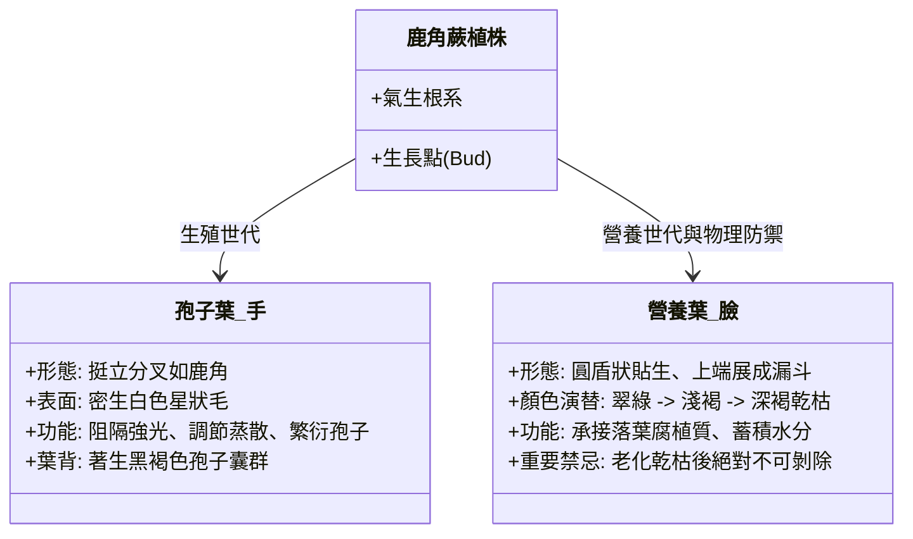

# 鹿角蕨生長生理與上板栽培技術

## 一、植物學分類與二型葉分化

鹿角蕨屬於水龍骨科（Polypodiaceae）鹿角蕨屬（*Platycerium*），原產於熱帶與亞熱帶熱帶雨林，為高度演化的著生型（附生型）植物 [^SRC-03]。鹿角蕨最引人注目的特徵在於其植株演化出兩種外型、質地與功能截然不同的葉片，此現象在植物學上稱為**「二型葉現象（Dimorphic fronds）」**[^SRC-03]：



### 1. 孢子葉（Fertile Frond / 有稔性葉 / 俗稱「手」）
* **形態特徵**：葉片直立向上伸展或優美下垂，質地厚實革質，先端深裂分叉如雄鹿之角 [^SRC-03]。
* **星狀毛防禦機制**：葉表密布一層銀白色極細密的星狀毛（Stellate hairs）。此微觀構造能反射熱帶林冠過剩之紫外線與強光，並在葉表形成微氣候邊界層，大幅減少水分蒸散流失 [^SRC-03]。
* **生殖功能**：葉片發育成熟後，葉背或特定裂片末端會群聚著生大面積黑褐色之「孢子囊群」，專責散播微小孢子以完成有性繁衍 [^SRC-03]。詳見 [[fern-biology-and-morphology|蕨類植物生物學與形態特徵]]。

### 2. 營養葉（Sterile Frond / 不稔性葉 / 俗稱「臉」或「盾狀葉」）
* **形態特徵**：基部扁平圓形或橢圓形，邊緣波狀或王冠狀向上伸展，緊密貼合包覆所依附之樹幹或板材 [^SRC-03]。
* **色澤演替與腐植質收集**：
  * **幼期**：新生營養葉呈鮮嫩翠綠色，具光合作用活性 [^SRC-03]。
  * **成熟與老化期**：隨時間逐步木質化轉為淺褐色乃至深褐色乾燥革質 [^SRC-03]。
  * **生態功能**：向上開展的葉緣如同一只天然垃圾桶，承接樹冠掉落之枯葉碎屑、蟲鳥糞便與雨露。層層疊疊的乾枯老葉在內部形成極度疏鬆的海綿狀天然腐植質層，為根系提供透氣、保水與吸附養分的溫床 [^SRC-03]。
* **重要養護禁忌**：**營養葉轉褐乾枯純屬自然成熟老化現象，絕非植株枯死，切忌強行剝除或修剪**！若將老臉剝除，根系將直接暴露於乾枯空氣中而嚴重受創 [^SRC-03]。

---

## 二、生長環境與溫濕度數據

依據桃園區農業改良場之試驗數據，鹿角蕨之環境生理閾值如下 [^SRC-03]：

```text
【鹿角蕨生長環境數據速查】
最適生長溫度：18℃ 至 30℃ [^SRC-03]
低溫生長停滯：低於 15℃ 生長趨緩進入半休眠 [^SRC-03]
極限低溫忍耐：短暫 5℃（必須嚴格控制介質偏乾、嚴禁澆灌冷水）[^SRC-03]
極限高溫忍耐：短暫 35℃（需加強通風與環境噴霧降溫）[^SRC-03]
光照要求：明亮無直射之均勻散射光（夏季適度遮陰約 50%）[^SRC-03]
```

---

## 三、上板材料與實務操作技術（綠竹板與水苔）

為落實環境永續並避免開採瀕危野生筆筒樹（蛇木資材），桃園農改場成功研發以回收綠竹稈製作成「綠竹板」替代傳統蛇木板 [^SRC-03]。

### 1. 綠竹板試驗結論
* 試驗針對皇冠鹿角蕨、女王鹿角蕨、何其美鹿角蕨、象耳鹿角蕨等多種市售苗株進行栽培測試 [^SRC-03]。
* **結果顯示**：綠竹板質地輕盈、抗腐防蛀、排水孔隙分布均勻且通氣性極佳。在相同溫室環境下，綠竹板組與傳統蛇木板組之生長勢評估**無統計顯著差異**，完全具備作為環保替代資材之優越特性 [^SRC-03]。

### 2. 標準上板操作步驟
1. **板材前置處理**：選定之綠竹板或厚實木板，在使用前務必**完全浸泡清水 1 日**，使其木質纖維吸飽水分沉降並釋出多餘單寧酸 [^SRC-03]。
2. **水苔介質調配**：選用長纖維、無粉塵之優質水苔，泡水泡發後輕輕擠出多餘水分（維持握在手中不滴水、鬆手不散團的濕潤度）。配方詳見 [[substrate-and-media|蕨類常用介質特性與調配指南]]。
3. **鋪墊與定位**：在板材中央預鋪一薄層水苔底，將脫盆修整好的鹿角蕨幼株端正置於其上。需特別注意生長點方向（芽苞開口朝上，孢子葉與營養葉開展朝向正確方位）。
4. **包覆與縛緊**：以適量水苔均勻覆蓋根系周圍，塑形為厚度約 4~6 公分、邊緣平順之半球形水苔球。
5. **固定工法**：使用透明魚線或防腐細棉繩，以十字或星形走向交錯纏繞將水苔球與植株穩固縛緊於板材上。**纏繞時線段必須避開核心生長點（芽苞）與嬌嫩的新葉初生緣**，避免勒傷分生組織 [^SRC-03]。

---

## 四、水分給予：關鍵的「乾濕循環」法則

水分管理是鹿角蕨栽培成敗的最核心關鍵。鹿角蕨根系為氣生附生根，對「積水缺氧」極度敏感，耐乾能力遠大於耐淹能力 [^SRC-03]。

### 1. 澆水頻率與季節調節
* **夏季高溫生長旺季**：蒸散作用強烈，約 **3 至 4 天澆水一次** [^SRC-03]。
* **冬季低溫半休眠期**：低溫蒸散緩慢且忌濕冷爛根，約 **1 星期澆水一次**（或延長至介質全乾後數日）[^SRC-03]。
* **乾濕循環操作原則**：必須嚴格遵守「**水苔球接近乾燥時再行灌水，乾透才澆透**」[^SRC-03]。

### 2. 正確澆水手法與警訊判斷
* **泡盆透心原則**：乾透的水苔表面具有疏水性，若僅以噴壺噴灑表面，水分往往沿外層流失而內部根系依然乾渴。澆水時必須將整塊栽培板**置於水桶中浸泡數分鐘**，確保水苔球內部徹底吸飽水分，取出瀝乾後再行懸掛 [^SRC-03]。
* **青苔過濕警訊**：若觀察到水苔球表面長期長滿一層綠色青苔或黑黏藻類，代表澆水過於頻繁、水分過剩且通風不良，極易誘發根腐病與營養葉黑腐爛心，應立即拉長澆水間隔並加強環境對流通風 [^SRC-03]。詳見 [[watering-and-humidity-management|水分供給與空氣濕度管理技術]]。

---

## 五、肥培管理要領

* **施用原則**：鹿角蕨附生根系細緻，切忌施用未發酵有機肥或高濃度化學速效肥，否則極易造成鹽害燒根 [^SRC-03]。
* **配方與稀釋比例**：
  * 推薦使用水溶性化學肥料 **花寶二號（通用型氮磷鉀平衡配比 20-20-20）** [^SRC-03]。
  * **稀釋倍數必須達到 2,000 倍**（比一般草花推薦倍數更稀薄）[^SRC-03]。
* **施用頻率**：生長旺盛期採「**澆水與澆肥輪流施用**」，每 2 至 3 次正常澆水後，施用一次稀薄肥液進行水苔球澆灌或全株葉面噴施即可 [^SRC-03]。

---

## 六、知識關聯與概念導航
* 基礎理論：[[fern-biology-and-morphology|蕨類植物生物學與形態特徵]]
* 橫向養護比對：
  * 著生漏斗型：[[asplenium-antiquum-care|臺灣山蘇花與巢蕨類栽培指南]]
  * 薄葉高濕型：[[adiantum-care|鐵線蕨薄葉特徵與高濕栽培指南]]
  * 抗旱走莖型：[[nephrolepis-biserrata-care|長葉腎蕨與腎蕨屬植物抗旱栽培指南]]
* 實務操作技術：
  * [[substrate-and-media|蕨類常用介質特性與調配指南]]
  * [[watering-and-humidity-management|水分供給與空氣濕度管理技術]]
  * [[environmental-control-and-troubleshooting|環境控制與新手疑難排解]]

---

## 參考文獻
[^SRC-03]: 李淑真, 〈鹿角蕨在綠竹板之栽培技術〉, 《桃園區農業專訊》第 114 期, 農業部桃園區農業改良場 / 農業知識入口網, [https://kmweb.moa.gov.tw/knowledgebase.php?id=404842](https://kmweb.moa.gov.tw/knowledgebase.php?id=404842).
