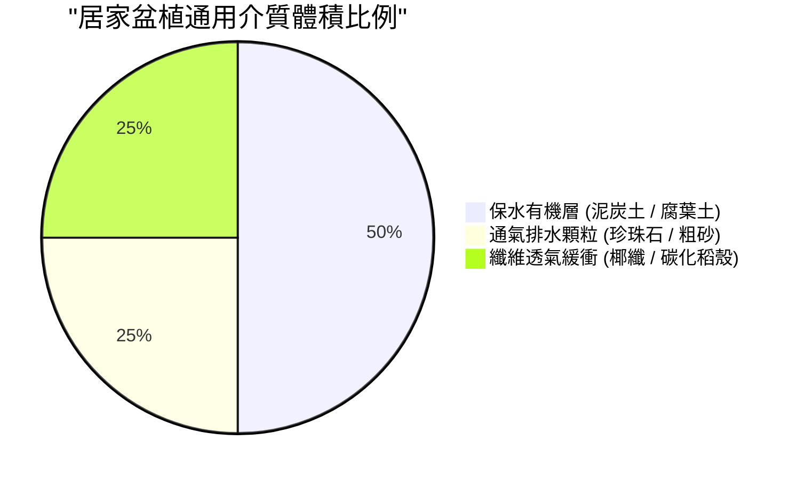

# 蕨類常用介質特性與調配指南

## 一、介質選擇的核心植物學生理原則

蕨類植物根系細緻纖弱，多數缺乏主根與發達的次生木質化組織，呼吸強度高且對土壤通氣孔隙極為敏感 [^SRC-01]。傳統園藝栽培新手常犯的致命錯誤，在於直接取用户外黏重沉滯的田土或黃土種植蕨類，導致澆水後顆粒孔隙完全被微粒泥漿填塞，根系在缺氧狀態下窒息腐爛（根腐病）[^SRC-03][^SRC-05]。

調配蕨類介質的三大物理核心指標：
1. **毛細孔隙與保水力（Water Retention）**：能均勻吸附足夠水分，供根系吸收，但不積聚游離死水。
2. **通氣孔隙與排水性（Air Permeability & Drainage）**：澆水後多餘水分能在數秒內迅速自盆底排出，空氣隨即被負壓吸入介質孔隙中，提供根系有氧呼吸環境。
3. **結構抗腐穩定性（Structural Durability）**：不易在短期內酸化崩解結塊，並維持適度之有機質釋放。

---

## 二、常見蕨類栽培資材特性解析

### 1. 水苔（泥炭蘚 / Sphagnum Moss）
* **物理特性**：由乾製泥炭蘚加工而成，吸水量可達自身乾重 15 至 20 倍。纖維結構中富含大量微孔，具有優異的保水與緩衝性 [^SRC-03]。
* **最佳應用**：
  * [[platycerium-care-and-mounting|鹿角蕨上板]] 之核心根系包覆資材 [^SRC-03]。
  * [[asplenium-antiquum-care|山蘇花]] 與 [[adiantum-care|鐵線蕨]] 之孢子播種保濕基質 [^SRC-02][^SRC-04]。
* **操作要領**：使用前需以清水充分浸泡泡發，瀝乾至手握不滴水狀態；包裹時不可過度緊壓壓實，否則內部通氣孔隙喪失，易導致爛根 [^SRC-03]。

### 2. 綠竹板與環保板材
* **物理特性**：桃園區農業改良場利用回收之綠竹稈加工製成，質地輕盈、抗腐防蛀，具備天然毛孔且排水通氣極速 [^SRC-03]。
* **最佳應用**：附生型蕨類（[[platycerium-care-and-mounting|鹿角蕨]]、著生山蘇）上板載體，完全可替代瀕危野生蛇木板 [^SRC-03]。
* **操作要領**：使用前需預先浸泡清水 1 日使板材吸飽水分沉澱 [^SRC-03]。

### 3. 泥炭土（Peat Moss）
* **物理特性**：沼澤苔蘚植物經數千年微厭氧腐化之泥炭化沉積物，質地鬆軟、酸鹼度約在 pH 5.5~6.5，富含有機質但本身排水性中等，不可單獨使用 [^SRC-04][^SRC-05]。
* **最佳應用**：各類地生盆植蕨類（[[nephrolepis-biserrata-care|長葉腎蕨]]、[[adiantum-care|鐵線蕨]]）的基礎保水有機層 [^SRC-04][^SRC-05]。

### 4. 珍珠石（Perlite）
* **物理特性**：天然矽質火山岩經高溫膨脹形成之白色多孔輕質顆粒，化學性質極為安定，無吸肥性亦不吸附水，能長年維持介質內部之宏觀通氣孔隙，大幅提升介質透氣性 [^SRC-04][^SRC-05]。

### 5. 椰纖（椰糠 / Coco Coir）與樹皮
* **物理特性**：天然椰子外殼或松樹皮纖維加工而成，排水透氣極佳，不易腐爛結塊，為優質之蛇木屑替代資材 [^SRC-02][^SRC-05]。

---

## 三、四大入門代表品種專屬配土方案

不同生態棲位的蕨類對介質通氣、保水與酸鹼度要求差異顯著，不可一套配方通套到底 [^SRC-02][^SRC-03][^SRC-04][^SRC-05]。地生盆植常見之「泥炭土 50% + 珍珠石 25% + 椰糠/粗砂 25%（約 2:1:1 體積比）」僅為常見搭配示例，著生蕨類（如鹿角蕨）則需採用純水苔上板，不可混為一談：

| 品種代表 | 生態類型 | 專屬介質配比（體積比） | 特殊調配要點與禁忌 |
| :--- | :--- | :--- | :--- |
| **[[platycerium-care-and-mounting\|鹿角蕨]]** | 典型氣生著生型 | **100% 長纖維優質水苔** 搭配 **綠竹板 / 實木板** [^SRC-03] | 水苔不可壓太實；板材先浸泡 1 日；嚴禁使用黏重土壤盆植，否則必爛心 [^SRC-03]。 |
| **[[asplenium-antiquum-care\|臺灣山蘇花]]** | 著生漏斗型 | **腐熟樹皮 40% + 椰纖 30% + 水苔 30%** （或盆植泥炭土:顆粒:樹皮 = 1:1:1）[^SRC-02] | 要求極高通氣度；氣生根需要大量孔隙；維持底孔通暢、嚴禁底盤積水 [^SRC-02]。 |
| **[[adiantum-care\|鐵線蕨]]** | 薄葉地生型 | **泥炭土 50% + 珍珠石 25% + 粗砂 25%** [^SRC-04] | 保水力要求最高；喜微鹼偏鈣，可酌加 1 茶匙熟石灰或碎蚵殼粉 [^SRC-04]。 |
| **[[nephrolepis-biserrata-care\|長葉腎蕨]]** | 強健地生/附生型 | **泥炭土 50% + 珍珠石 25% + 椰糠 25%** [^SRC-05] | 見乾見濕；排水通透即可；盆底孔洞排水必須通暢，忌長期浸水 [^SRC-05]。 |

---

## 四、換盆與介質更新操作要領

1. **換盆最佳時機**：每年 **3 月至 5 月（春季氣溫穩定回升至 20℃ 以上之際）**，新芽捲旋展葉活性旺盛，傷口癒合快速 [^SRC-02][^SRC-04]。
2. **根系修整**：
   * 脫盆後輕輕抖除外圍 1/3 老化介質。
   * 檢視根系，以消毒剪刀修除黑色萎縮之死根與空心根，保留健全之白色或淡黃色活性根尖。
3. **容器排水孔與避免積水（破除盆底鋪石迷思）**：
   * **破除盆底墊粗石排水迷思**：現代園藝科學（如伊利諾大學推廣處容器栽培指南）指出，在盆底鋪設粗碎石或陶粒並不會改善排水，反而因介質孔隙質地驟變形成「懸著水盤效應（Perched Water Table）」，將飽和積水層推高至植物根系生長區。
   * **正確做法**：選用具備良好底孔之透氣花盆，全盆維持均勻、疏鬆、多孔隙之配土，澆水後讓多餘水分迅速流出，並定期倒除底盤積水，避免根系常年泡水缺氧。
4. **換盆後管理**：換盆定植完成後必須立即「**澆透定根水**」，置於無直射光、通風良好的半陰處靜置養護 1~2 週，期間保持葉面微濕，暫停施肥直至新葉萌發展開 [^SRC-02][^SRC-04]。

---

## 五、知識關聯與概念導航
* 基礎理論：[[fern-biology-and-morphology|蕨類植物生物學與形態特徵]]
* 各品種實務：
  * [[asplenium-antiquum-care|臺灣山蘇花與巢蕨類栽培指南]]
  * [[platycerium-care-and-mounting|鹿角蕨生長生理與上板栽培技術]]
  * [[adiantum-care|鐵線蕨薄葉特徵與高濕栽培指南]]
  * [[nephrolepis-biserrata-care|長葉腎蕨與腎蕨屬植物抗旱栽培指南]]
* 水分與環控配合：
  * [[watering-and-humidity-management|水分供給與空氣濕度管理技術]]
  * [[environmental-control-and-troubleshooting|環境控制與新手疑難排解]]

---

## 參考文獻
[^SRC-01]: 農業部林業試驗所 / 台北植物園館, 〈蕨類植物區〉, 農業知識入口網, [https://kmweb.moa.gov.tw/subject/subject.php?id=27202](https://kmweb.moa.gov.tw/subject/subject.php?id=27202).
[^SRC-02]: 陳俊仁、謝桑煙、黃山內, 〈山蘇花品種、習性及繁殖方法〉, 農業部臺南區農業改良場 / 農業部全球資訊網, [https://www.moa.gov.tw/ws.php?id=2573](https://www.moa.gov.tw/ws.php?id=2573).
[^SRC-03]: 李淑真, 〈鹿角蕨在綠竹板之栽培技術〉, 《桃園區農業專訊》第 114 期, 農業部桃園區農業改良場 / 農業知識入口網, [https://kmweb.moa.gov.tw/knowledgebase.php?id=404842](https://kmweb.moa.gov.tw/knowledgebase.php?id=404842).
[^SRC-04]: 農業部高雄區農業改良場, 〈[綠化美化] 鐵線蕨〉, 高雄區農業改良場全球資訊網, [https://www.kdais.gov.tw/ws.php?id=2206](https://www.kdais.gov.tw/ws.php?id=2206).
[^SRC-05]: 李文南、陳敬文、陳姿吟 等, 《原生蕨類長葉腎蕨之栽培管理與應用》, 臺東區農業改良場技術專刊第 71 輯, 農業知識入口網, [https://kmweb.moa.gov.tw/theme_data.php?id=2312&theme=agri_book](https://kmweb.moa.gov.tw/theme_data.php?id=2312&theme=agri_book).
