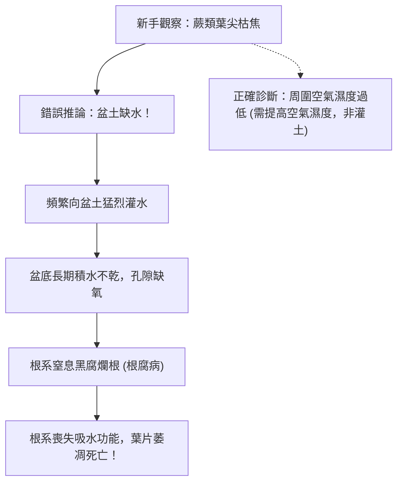
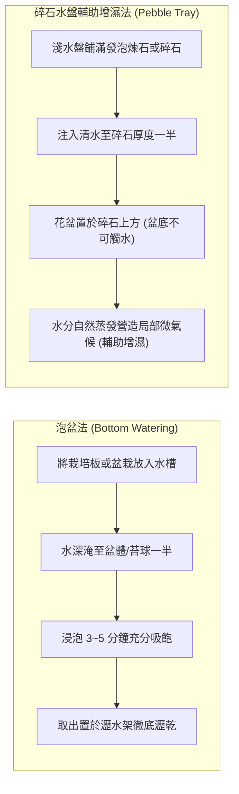

# 水分供給與空氣濕度管理技術

## 一、水分之於蕨類的雙重植物學意義

水分是決定蕨類栽培存活與否的第一核心要素，其在蕨類生活史中具備兩項至關重要的生理功能 [^SRC-01]：
1. **生殖繁衍的物理媒介**：如 [[fern-biology-and-morphology|蕨類植物生物學與形態特徵]] 所述，蕨類有性世代的受精作用**必須在原葉體表面存在一層連續游離水膜的條件下，具鞭毛之精子才能游動與卵結合** [^SRC-01]。
2. **葉片膨壓維持與微氣候緩衝**：蕨類植物多數葉片角質層發達程度遠遜於種子植物，抗蒸散能力弱。一旦環境空氣相對濕度過低，蒸散速率超越根系吸水速率，細胞膨壓迅速喪失，導致小羽片不可逆之焦邊枯卷 [^SRC-04]。

---

## 二、「空氣濕度」與「盆土水分」的本質區別

新手栽培蕨類最常見的致命認知盲區，在於**將「空氣濕度」與「土壤水分」混為一談** [^SRC-03][^SRC-04]：



* **空氣濕度（相對濕度 RH）**：指的是葉片周遭大氣中所含水蒸氣的飽和度。薄葉型如 [[adiantum-care|鐵線蕨]] 原生於溪畔陰濕岩壁，需要維持高空氣濕度環境（園藝經驗值約 70%~90% [待查證/通說]），以減少薄羽片的水分散失 [^SRC-04]。
* **土壤水分**：指的是 [[substrate-and-media|介質]] 孔隙中所吸附的水分。根系需要的是「水氣與氧氣並存」的濕潤狀態，**絕非常年泡在死水中** [^SRC-03][^SRC-05]。

---

## 三、兩大主流澆水策略：乾濕循環 vs 見乾見濕

依據不同物種的生態解剖構造，必須採取完全不同的給水節奏 [^SRC-02][^SRC-03][^SRC-04][^SRC-05]：

```text
【四大品種給水模式速查】
鹿角蕨：嚴格遵守「乾濕循環」（乾透再澆透，夏 3~4 日，冬 1 週，忌青苔過濕）[^SRC-03]
鐵線蕨：遵守「常態微濕潤」（淺根耐旱差，忌盆土全乾，需搭配高空氣濕度）[^SRC-04]
長葉腎蕨：遵守「見乾見濕」（革質厚葉抗蒸散耐微旱，表土 1~2 公分乾再澆透）[^SRC-05]
臺灣山蘇花 / 山蘇花：遵守「微濕通風」（氣生根需高透氣，介質微濕潤，夏季早晨噴霧）[^SRC-02]
```

### 1. 策略一：嚴格的「乾濕循環」法則（代表：鹿角蕨）
* **適用對象**：著生於樹幹或板植之 [[platycerium-care-and-mounting|鹿角蕨]] [^SRC-03]。
* **操作要領**：
  * **夏季高溫生長旺盛期**：約 **3 至 4 天澆水一次** [^SRC-03]。
  * **冬季低溫半休眠期**：約 **1 星期澆水一次** [^SRC-03]。
  * **給水判斷指標**：掂量板材重量或手指按壓水苔球外層。唯有當水苔球「接近乾燥、整體重量顯著變輕」時，方可進行下一次灌水 [^SRC-03]。
  * **青苔過濕警訊**：若觀察到水苔表面長期被一層翠綠青苔所覆蓋，即代表澆水過於頻繁，根系內部已長期積水缺氧，應立即拉長澆水天數並移至通風處 [^SRC-03]。

### 2. 策略二：見乾見濕與常態微濕（代表：腎蕨與鐵線蕨）
* **見乾見濕（長葉腎蕨）**：待盆土表面約 1~2 公分發白乾燥時再澆水。長葉腎蕨成熟羽葉具厚角質層且根系發達，耐旱性良好，偶爾遲延 1~2 天給水無虞 [^SRC-05]。（註：同屬之腎蕨 *N. cordifolia* 另具備特化地下儲水球莖）。
* **常態微濕潤（鐵線蕨）**：根系分布淺且薄葉蒸散快，不可等到盆土乾燥發白才澆水。必須每天巡視，維持盆土表面微黑濕潤 [^SRC-04]。

---

## 四、澆水時間點與手法操作規範

### 1. 澆水時間的學問（忌夜間澆水滯水）
* **最佳時機：早晨（上午 7:00 ~ 9:00）**
  * 清晨澆水後，植株在白天光照下進行蒸散與光合作用，水分被根系迅速吸收並自葉面散失，多餘水分能隨白天升溫與氣流自然揮發 [^SRC-02]。
* **嚴禁行為：夜間向葉片與芽心猛烈澆水**
  * 夜間氣溫下降且氣流停滯，水分若長時間滯留在葉片細密縫隙或中心生長點（如山蘇心部、鹿角蕨芽苞），極易在低溫高濕微環境中誘發真菌性炭疽病與細菌性軟腐病，導致生長點黑腐潰爛 [^SRC-02][^SRC-03]。詳見 [[environmental-control-and-troubleshooting|環境控制與新手疑難排解]]。

### 2. 兩大實用澆水手法



#### A. 泡盆法（底吸浸透法 / Bottom Watering）
* **適用情境**：板植 [[platycerium-care-and-mounting|鹿角蕨]]、乾燥結塊之泥炭土盆栽、以及葉片細碎密集的 [[adiantum-care|鐵線蕨]] [^SRC-03][^SRC-04]。
* **操作步驟**：
  1. 準備一裝水容器，水溫需與室溫相當。
  2. 將鹿角蕨栽培板或鐵線蕨盆花下半部浸入水中，深度約達苔球或盆高一半 [^SRC-03]。
  3. 靜置浸泡約 3~5 分鐘，利用毛細管虹吸作用使介質自下而上徹底吸飽水分，避免由上方澆水時水分僅從表層流失而中心依然乾燥之假濕現象 [^SRC-03]。
  4. 取出後懸掛或傾斜放置，**務必徹底瀝乾多餘滴水**後再放回原位 [^SRC-03]。

#### B. 碎石水盤輔助增濕法（Pebble Tray）
* **適用情境**：室內冷氣房或乾燥陽台栽培 [[adiantum-care|鐵線蕨]] 與幼苗之輔助增濕 [^SRC-04]。
* **操作步驟**：
  1. 取一淺底水盤，盤內鋪滿 2~3 公分厚之發泡煉石、火山石或鵝卵石 [^SRC-04]。
  2. 盤內注水，**水位高度維持在碎石層一半，嚴禁淹過碎石表面** [^SRC-04]。
  3. 將盆栽平穩放置於碎石層上方。花盆底部排水孔未直接浸泡於水中（防止爛根），底盤水分自然蒸發可作為居家輔助增濕方法，在植株周遭形成濕度緩衝微氣候，減緩薄葉水分快速散失；唯此法屬輔助性質，受室內氣流通風影響，不可保證能達到特定空氣相對濕度數值 [^SRC-04]。

---

## 五、知識關聯與概念導航
* 基礎理論：[[fern-biology-and-morphology|蕨類植物生物學與形態特徵]]
* 各品種實務：
  * [[asplenium-antiquum-care|臺灣山蘇花與巢蕨類栽培指南]]
  * [[platycerium-care-and-mounting|鹿角蕨生長生理與上板栽培技術]]
  * [[adiantum-care|鐵線蕨薄葉特徵與高濕栽培指南]]
  * [[nephrolepis-biserrata-care|長葉腎蕨與腎蕨屬植物抗旱栽培指南]]
* 介質與環境綜合配合：
  * [[substrate-and-media|蕨類常用介質特性與調配指南]]
  * [[environmental-control-and-troubleshooting|環境控制與新手疑難排解]]

---

## 參考文獻
[^SRC-01]: 農業部林業試驗所 / 台北植物園館, 〈蕨類植物區〉, 農業知識入口網, [https://kmweb.moa.gov.tw/subject/subject.php?id=27202](https://kmweb.moa.gov.tw/subject/subject.php?id=27202).
[^SRC-02]: 陳俊仁、謝桑煙、黃山內, 〈山蘇花品種、習性及繁殖方法〉, 農業部臺南區農業改良場 / 農業部全球資訊網, [https://www.moa.gov.tw/ws.php?id=2573](https://www.moa.gov.tw/ws.php?id=2573).
[^SRC-03]: 李淑真, 〈鹿角蕨在綠竹板之栽培技術〉, 《桃園區農業專訊》第 114 期, 農業部桃園區農業改良場 / 農業知識入口網, [https://kmweb.moa.gov.tw/knowledgebase.php?id=404842](https://kmweb.moa.gov.tw/knowledgebase.php?id=404842).
[^SRC-04]: 農業部高雄區農業改良場, 〈[綠化美化] 鐵線蕨〉, 高雄區農業改良場全球資訊網, [https://www.kdais.gov.tw/ws.php?id=2206](https://www.kdais.gov.tw/ws.php?id=2206).
[^SRC-05]: 李文南、陳敬文、陳姿吟 等, 《原生蕨類長葉腎蕨之栽培管理與應用》, 臺東區農業改良場技術專刊第 71 輯, 農業知識入口網, [https://kmweb.moa.gov.tw/theme_data.php?id=2312&theme=agri_book](https://kmweb.moa.gov.tw/theme_data.php?id=2312&theme=agri_book).
